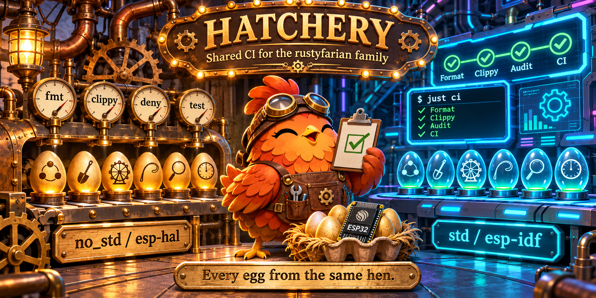

# rustyfarian-ci

<p align="center">
  
</p>

Shared GitHub Actions for the rustyfarian repos: a reusable host-checks workflow and composite setup actions.
The family conventions live in [`conventions/`](conventions/), indexed by [`CONVENTIONS.md`](CONVENTIONS.md); callers follow [`conventions/ci.md`](conventions/ci.md).

## Contents

- `.github/workflows/host-checks.yml` — reusable workflow; runs one `just ci-<check>` recipe (`fmt`, `clippy`, `test`, `deny`, `audit`).
- `.github/actions/setup-rust-just` — composite action: Rust toolchain, cargo cache, `just`, optional cargo tools.
- `.github/actions/setup-xtensa` — composite action: the `esp` toolchain via `esp-rs/xtensa-toolchain`, cached by version.
- `.github/actions/setup-esp-idf` — composite action: `ldproxy`, the `~/.espressif` cache and the esp-idf-sys environment.
- `.github/actions/setup-avr` — composite action: `avr-gcc` and the pinned AVR nightly.
- `.github/workflows/smoke-targets.yml` — builds the blink fixture on all 9 family targets (4 esp-hal, 4 ESP-IDF, AVR).
- `.github/workflows/host-smoke.yml` — calls `host-checks.yml` for all five checks and runs `setup-rust-just` directly.
- `fixtures/` — the blink smoke fixture: a host-tested `embedded-hal` library and one firmware crate per runtime.

## Usage

```yaml
jobs:
  clippy:
    uses: datenkollektiv/rustyfarian-ci/.github/workflows/host-checks.yml@v1
    with:
      check: clippy
```

The calling repo provides the `just ci-clippy` recipe.
Caller rules, pins and templates: [`conventions/ci.md`](conventions/ci.md).

## Composite action internals

- rust-cache keys on the job id, and every job of a reusable workflow has the same id (`check`): pass `cache-key` so jobs don't overwrite each other's cache.
- `host-checks.yml` caches only `clippy` and `test`, keyed by the check; `fmt`, `deny` and `audit` compile nothing.
- `setup-xtensa` caches `~/.rustup/toolchains/esp` by version and `buildtargets`; `actions/cache` rejects commas, so `esp32,esp32s3` becomes `esp32-esp32s3` in the key.
- espup installs the `esp` toolchain only for an Xtensa target, which is why RISC-V ESP-IDF jobs pass `buildtargets: esp32`.
- `setup-esp-idf` installs the pinned `ldproxy` release, caches `~/.espressif` by IDF version and MCU, and exports `ESP_IDF_VERSION`, `ESP_IDF_TOOLS_INSTALL_DIR=global` and `MCU`.
- `setup-avr` installs `avr-gcc`, `binutils-avr` and `avr-libc` from apt, plus the AVR nightly with `rust-src`.
- `host-checks.yml` references `setup-rust-just` by full ref (`…/setup-rust-just@v1`): a relative `./` path would resolve against the caller's checkout, so a `v2` release bumps that inner ref too.

## Local testing

Point `act` at a local checkout of this repo:

```sh
act -j clippy --pull=false -P ubuntu-latest=catthehacker/ubuntu:act-latest --local-repository datenkollektiv/rustyfarian-ci@v1=../rustyfarian-ci
```

## Smoke fixtures

This repo tests its own actions on a "blink one LED" fixture that builds on every target in the family.

| Chip | esp-hal (`no_std`) | ESP-IDF (std) | LED |
|:-----|:-------------------|:--------------|:----|
| esp32 | `xtensa-esp32-none-elf` | `xtensa-esp32-espidf` | GPIO2 (ESP32 DevKit V1) |
| s3 | `xtensa-esp32s3-none-elf` | `xtensa-esp32s3-espidf` | GPIO35 (Heltec WiFi LoRa 32 V3) |
| c3 | `riscv32imc-unknown-none-elf` | `riscv32imc-esp-espidf` | GPIO7 (ESP32-C3-DevKit-RUST-1) |
| c6 | `riscv32imac-unknown-none-elf` | `riscv32imac-esp-espidf` | GPIO15 (Seeed XIAO ESP32C6) |
| atmega328p | `avr-none` (avr-hal) | n/a | D13 (Arduino Nano) |

- `fixtures/blink` is the only root workspace member: a host-tested `Blinker` over `embedded-hal` 1.0.
- `fixtures/blink-esp-hal`, `blink-esp-idf` and `blink-avr` are excluded from the root workspace and have their own `Cargo.lock` and `target/`.
- Toolchains: `esp` for Xtensa esp-hal and every ESP-IDF build, `stable` with the prebuilt rustup target for RISC-V esp-hal, the AVR nightly for AVR.
- `-Zbuild-std=core` for Xtensa esp-hal and AVR, `-Zbuild-std=std,panic_abort` for ESP-IDF.
- `smoke-targets.yml` runs one matrix job per row and runtime; each runs `just ci-blink <runtime> <chip>`.
- `host-smoke.yml` calls `host-checks.yml` for all five checks and runs `setup-rust-just` directly.
- Dependabot groups `esp-idf-*` with `embuild`, because `esp-idf-sys` is a `links` crate.
- avr-hal is pinned by git rev `e5c8f37fe48419956e722490a82b9ca9b9fc61a2`.

The fixtures build locally with the same recipes CI runs.
The firmware recipes need espup (`esp` toolchain), `ldproxy` and `avr-gcc`; `just doctor` reports what is missing, `just setup` installs the rustup parts.

```sh
just doctor
just ci
just blink-hal s3
just blink-idf c6
just blink-avr
just act-list
```

## Releasing

`host-checks.yml` resolves `setup-rust-just@v1` from GitHub, so the host-smoke `uses:` jobs test the published `v1`, not the PR's copy.
On a fresh remote, push `main` and the `v1` tag first; until then those five jobs fail at "Setup Rust and just".

Every release gets a new immutable `vX.Y.Z` tag and moves the major tag callers pin; never re-point a `vX.Y.Z` tag.
Patch for fixes, minor for new actions, inputs or changed defaults, a new major (`v2`) for breaking changes.
`just release` tags `origin/main` with both as annotated tags and pushes them after one confirmation.
It refuses a dirty tree, a branch other than `main`, a `main` that differs from `origin/main`, and an existing version tag.

```sh
just release 1.1.0
```

## License

MIT, see [`LICENSE`](LICENSE).
