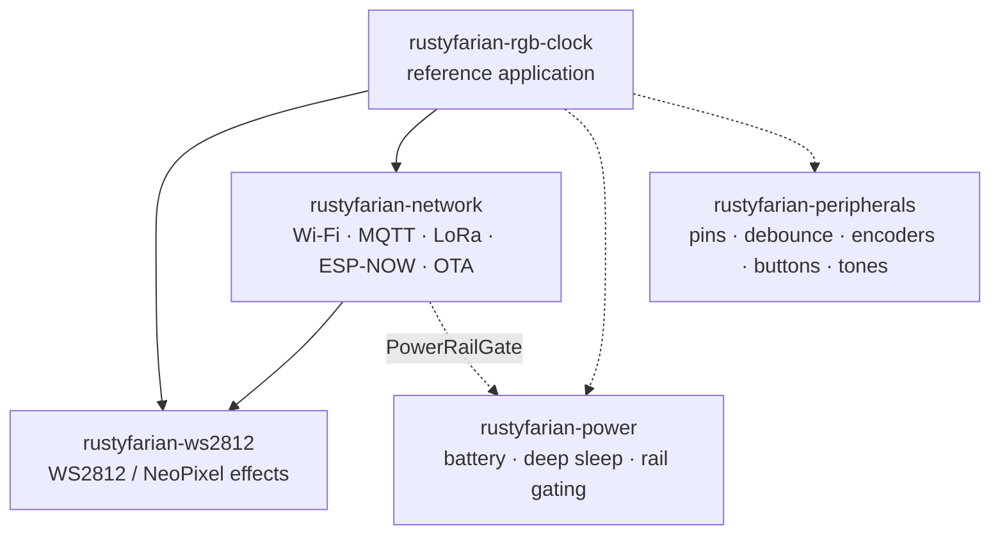

# Convention: README Business Card

Every rustyfarian repo presents itself the same way: README, licence files, and GitHub metadata.
Checked by the `family-resemblance` skill (`/family-resemblance card`); this file is the single source of the rules.
Change a rule here, bump `version`, and every repo picks it up on its next run.

## Repo Types

| Type | Signal | Examples |
|:-----|:-------|:---------|
| `library` | Cargo workspace, no binary package | ws2812, network, peripherals, power |
| `firmware` | A package with `src/main.rs` or `[[bin]]` | rgb-clock, knob |
| `python-tool` | `pyproject.toml`, no `Cargo.toml` | bench |
| `private` | Modifier: the repo is not public on GitHub | knob |

`{kind}` below is `library` for `library` repos and `project` for every other type.

## Skeleton

Top of the README, in this order, nothing in between:

1. Title `# Rustyfarian <Name>` — `<Name>` is free text (`WS2812 Related Crates`, `Power Management`).
2. Banner block.
3. Badge block.
4. Intro: the pitch paragraph first, then the AI note somewhere before the first H2; a short TL;DR command may sit in between.

Then these H2 sections, in this order, as the first three H2s:

1. `## Vision`
2. `## Rustyfarian Philosophy` — omitted by `python-tool`.
3. `## Rustyfarian Family`

Then the type-specific body, ending with:

- `library`: a `## Crates` section somewhere in the body.
- All types: an H2 that starts with `Development`.
- All types: `## License` as the last H2, and the last thing in the file.

## Banner

```html
<p align="center">
  .png"
       alt="<mascot> — <role>. <one-sentence scene description>"
       width="720">
</p>
```

- Mascot per repo, image under `docs/`.
- Recommended, not checked: file name `steampunk-meets-future-<preposition>-<place>.png` (`in-power-lab`, `on-testing-bench`).
- Recommended, not checked: alt text `<mascot> — <role>. <one-sentence scene>`.
- `private` repos may omit the banner.

### Series style

Every banner is one picture in the same series.
Image prompt for a new one — fill the `<…>` slots:

> Wide banner illustration, about 5:2, at least 1774 px wide, in the rustyfarian "steampunk meets future" series.
> Left half: a warm brass-and-copper steampunk <left scene>, with a small sign reading `no_std / esp-hal`.
> Right half: a cool neon futuristic <right scene>, with a small sign reading `std / esp-idf`.
> Centre, bridging both halves: the chibi <mascot> mascot <action>, an ESP32 board on each side.
> Above the mascot a name sign reading "<mascot>"; below, a tagline plaque reading "One chip. Two universes."
> Match the palette, line weight and lighting of the existing banners; no other text in the image.

## Badges

`library` and `firmware`, in this order (`<repo>` is the GitHub repo name):

```markdown
[](https://github.com/datenkollektiv/<repo>/actions/workflows/rust.yml)
[](#license)
[](https://www.rust-lang.org)
[](https://github.com/datenkollektiv/<repo>/actions/workflows/fmt.yml)
[](https://github.com/datenkollektiv/<repo>/actions/workflows/clippy.yml)
[](https://github.com/datenkollektiv/<repo>/actions/workflows/audit.yml)
```

`python-tool`, in this order:

```markdown
[](https://github.com/datenkollektiv/<repo>/actions/workflows/<workflow>.yml)
[](#license)
[](pyproject.toml)
[](https://github.com/astral-sh/ruff)
[](https://mypy.readthedocs.io/)
```

- The CI badge's alt text may name the workflow (`Verify`).
- Extra badges (release, uv, crates.io) may follow the required ones, never precede them.
- Every workflow badge points at a file that exists in `.github/workflows/`.
- Workflow `name:` values stay stable so badge URLs keep working.

### Rust badge label

`<msrv>` is the shields *message* (the part after `rust-`), derived from the `rust-version` fields of the workspace packages; packages without one are ignored:

- One distinct value `1.95` → `1.95+`.
- Several values → each as `<version>+ <scope>`, joined by ` | ` (`1.88+ tamer | 1.95+ esp tiers`); `<scope>` is free text.
- No package declares one → `esp-toolchain`, linking `https://github.com/esp-rs/rust` instead.

Shields escaping: `-` → `--`, space → `%20`, `+` → `%2B`, `|` → `%7C`.
Scopes use letters, digits, spaces and `-` only.

## AI Note

```markdown
> **Note:** Large parts of this {kind} (and its documentation) were developed with the assistance of AI tools.
> All generated code has been reviewed and curated by the maintainer.
```

## Philosophy

The section opens with this sentence, verbatim; the bullets after it are the repo's own and name its own crates:

```markdown
This {kind} embodies the principle of **extracting testable pure logic from hardware-specific code** — a pattern common in application development but rare in embedded Rust.
```

## Family

Public repos list **public crate repos only**.
`private` repos carry the same block and may add a `### Private family` subsection after it, linking other private repos.

The block, verbatim, with two permitted per-repo edits:

- `<repo>` in the opening sentence is the repo's own name.
- A family member marks itself: its diagram label gains `<br/>(this repo)`, and the Repo cell of its table row becomes `**<repo>** (this repo)` with no link; the Role cell stays.

One or more repo-specific sentences may follow the table.

````markdown
## Rustyfarian Family

`<repo>` is one repo in the **rustyfarian** family — composable embedded-Rust libraries for battery-powered ESP32 field deployments (e.g. remote beehive monitoring over LoRaWAN).



Solid edge: depends on it today.
Dotted edge: a natural fit, not adopted yet.

| Repo                                                                             | Role                                                    |
|:---------------------------------------------------------------------------------|:--------------------------------------------------------|
| [rustyfarian-ws2812](https://github.com/datenkollektiv/rustyfarian-ws2812)       | WS2812 / NeoPixel LED effects and drivers               |
| [rustyfarian-network](https://github.com/datenkollektiv/rustyfarian-network)     | Wi-Fi, MQTT, LoRa, ESP-NOW, OTA                         |
| [rustyfarian-peripherals](https://github.com/datenkollektiv/rustyfarian-peripherals) | Pins, debounce, encoders, buttons, tones            |
| [rustyfarian-power](https://github.com/datenkollektiv/rustyfarian-power)         | Battery monitoring, deep sleep, power rail gating       |
| [rustyfarian-rgb-clock](https://github.com/datenkollektiv/rustyfarian-rgb-clock) | Reference application tying the libraries together      |
````

### Edge truth

- `A --> B` is solid exactly when a package in A depends on a crate B owns — any dependency kind, including dev and optional.
- Every other edge in the diagram is dotted.
- A dependency between members with no edge at all is a missing edge: add it here first, then let the repos follow.
- Last verified against Cargo.toml: 2026-11-13.

## License

Dual licence `MIT OR Apache-2.0`; files, README section, badge and package manifests must agree.

- Files: `LICENSE-MIT` and `LICENSE-APACHE` at the repo root, no bare `LICENSE`.
- Manifests: every workspace package's `license` is `MIT OR Apache-2.0`, directly or via `license.workspace = true`; `pyproject.toml` likewise.
- Example crates outside the workspace with `publish = false` are exempt.
- Relicensing is safe only while the maintainer is the sole contributor; verify per repo before changing files or manifests.

The README section, verbatim:

```markdown
## License

Licensed under either of

- [Apache License, Version 2.0](LICENSE-APACHE)
- [MIT License](LICENSE-MIT)

at your option.

Unless you explicitly state otherwise, any contribution intentionally submitted for inclusion in the work by you, as defined in the Apache-2.0 license, shall be dual licensed as above, without any additional terms or conditions.
```

## Agent Files

`AGENTS.md` at the repo root, so any AI tool finds the project guide.

## GitHub Metadata

Public repos only.

- Topics include the core set `rustyfarian`, `esp32`, `embedded-rust`.
- Rust repos add `rust`; `library` repos add `no-std`.
- Domain topics (`ws2812`, `mqtt`, `lora`, …) are free and not checked.
- Wiki and Projects are off.
- The description is set and claims no narrower scope than the README documents (no single chip the repo has outgrown).
- GitHub's detected licence is `MIT` or `Apache-2.0`, never `NOASSERTION`.

## Checks

Text comparisons ignore whitespace: line wrapping and spacing around `—` do not count as drift.

| ID  | Check                                                                    | Applies to |
|:----|:-------------------------------------------------------------------------|:-----------|
| C01 | Title is `# Rustyfarian <Name>`                                          | all        |
| C02 | Banner block directly under the title: centred, `docs/*.png`, width 720  | public     |
| C03 | Banner image file exists                                                 | public     |
| C04 | Required badges present, in order, before any extra badge                | all        |
| C05 | Every workflow badge points at an existing `.github/workflows/` file     | all        |
| C06 | License badge reads `MIT/Apache-2.0` and links `#license`                | all        |
| C07 | Rust badge label matches the derived `<msrv>`                            | Rust types |
| C08 | Pitch paragraph follows the badges                                       | all        |
| C09 | AI note text matches, and sits in the intro after the pitch              | all        |
| C10 | Vision is the first H2; Philosophy, then Family follow where present     | all        |
| C11 | Philosophy opens with the shared sentence                                | Rust types |
| C12 | Family block matches, allowing only the permitted per-repo edits         | all        |
| C13 | Family edges are true: solid exactly when the Cargo dependency exists    | all        |
| C14 | `library` has a `## Crates` section                                      | library    |
| C15 | An H2 starting with `Development` exists                                 | all        |
| C16 | `## License` is the last H2, its text matches, and nothing follows it    | all        |
| C17 | `LICENSE-MIT` and `LICENSE-APACHE` exist; no bare `LICENSE`              | all        |
| C18 | Every manifest `license` is `MIT OR Apache-2.0`                          | all        |
| C19 | `AGENTS.md` exists                                                       | all        |
| C20 | Topics include the core set for the repo's type                         | public     |
| C21 | Wiki and Projects are off                                                | public     |
| C22 | Description is set and no narrower than the README                       | public     |
| C23 | GitHub licence is `MIT` or `Apache-2.0`, not `NOASSERTION`               | public     |

"Rust types" means `library` and `firmware`.
"public" means every repo without the `private` modifier.
Check IDs are stable: retire an ID rather than renumber, so skill and history keep pointing at the same rule.
